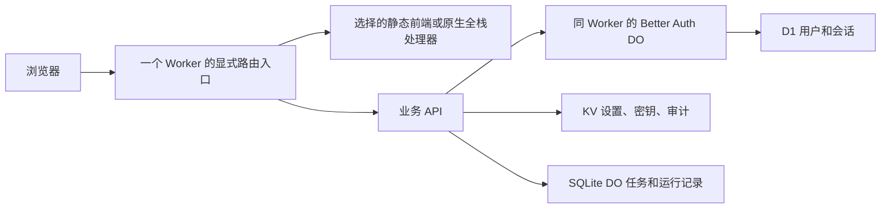

# 技术地图与选型

WorkerKit 是面向 Cloudflare Workers 的开发底座：选择一套界面或全栈起点，复用开源认证、存储与任务能力，再开发自己的业务。比较站把各方案放进同一个 Worker，正式应用只包含选择的方案。

## 先区分四层

| 名称 | 属于什么 | 负责什么 |
| --- | --- | --- |
| Vue / React | 前端框架 | 组件、状态、浏览器交互 |
| Nuxt UI | Vue 组件库 | Dashboard 侧栏、表单、表格、弹窗、主题；可以直接配 Vue/Vite |
| Dashboard Vue | Nuxt UI 官方 Vue/Vite 模板 | 页面布局示范，不是数据库或后端服务 |
| PrimeVue | Vue 组件库 | 提供表格、表单、菜单、弹窗和主题 |
| Sakai | 基于 PrimeVue 的后台模板 | 提供完整后台布局和导航 |
| Vben / PureAdmin / Soybean | 完整后台前端工程 | 布局、菜单、路由、主题；与 Nuxt UI 是候选关系 |
| Nuxt | 全栈框架 | Vue 页面、路由、服务端渲染、Nitro 服务端 API |
| Nitro | 服务端引擎 | Nuxt 的服务器路由和 Workers 构建适配 |
| NuxtHub | Nuxt 存储与缓存工具 | Drizzle/D1、KV、Blob/R2、Cache；不等于 CMS 或第二个后端托管服务 |
| Hono | Web API 框架 | 原生 Fetch 请求、路由、中间件、Cloudflare 绑定 |
| Better Auth | 认证库 | 用户、密码、角色、Cookie、D1 会话与撤销 |
| Payload / SonicJS | CMS 后端 | 原生用户、内容类型、媒体、角色和 API |
| WorkerKit | 显式装配与公共业务基础 | 请求/会话生命周期、任务、设置、密钥、审计、诊断、创建/升级工具 |

## 推荐从哪条路线开始

| 需求 | 组合 | 入口 |
| --- | --- | --- |
| 免费套餐下的管理型 Worker | Nuxt UI + Vue/Vite + Hono + Better Auth + D1/KV/SQLite DO | [默认管理方案](/standard/){target="_top"} |
| 完整 Nuxt 的路由和服务端生态 | Nuxt + Nuxt UI + Nitro + NuxtHub | [Nuxt 全栈](/hub/){target="_top"} |
| 内容、用户、媒体、角色与编辑发布 | 前端任选 + Payload 或 SonicJS | [比较](/?view=nuxt&backend=payload){target="_top"} |
| 对比其他全栈技术 | SvelteKit / Astro / React Router + Better Auth | [原生全栈验证](./frameworks) |
| 文档和知识内容 | VitePress | [文档入口](./guide) |
| 一个管理员账号管理应用 | Nuxt UI + Hono + KV 登录 | [Hono + KV 登录](/native/){target="_top"} |

用 Nuxt UI 并不是因为完整 Nuxt 无法部署到 Worker；二者都能部署。纯管理页面通常不需要每次请求都在服务器渲染，Vue/Vite 静态前端更直接；需要完整 Nuxt 时使用已经接入的全栈路线。

Nuxt UI 和 Vben 不会合作渲染同一个侧栏。选其中一个作为业务前端；共享 API、任务与权限协议，布局仍由各自原生组件实现。Payload 自带 React 管理界面，Vue UI 通过 API 使用它，不把 Vue 模板覆盖成 Payload 皮肤。

## 一个 Worker 的链路

DO 是 Cloudflare 原生绑定，仍属于同一个 Worker 的代码与部署；没有为了组合前后端再部署一个代理 Worker。CMS 的用户、内容和媒体继续交给上游；NuxtHub 当前保留原有 KV 管理员身份，SvelteKit/Astro/React Router 共用 Better Auth 身份，数据按应用命名空间分开。

演示账户 `admin / password`。CMS 身份相互独立，同一后端切换前端可复用身份。比较站的写操作会写入真实演示存储。正式项目使用自己的 Secret、初始凭据、绑定和迁移。

[功能矩阵](./features) · [升级维护](./upgrades)
